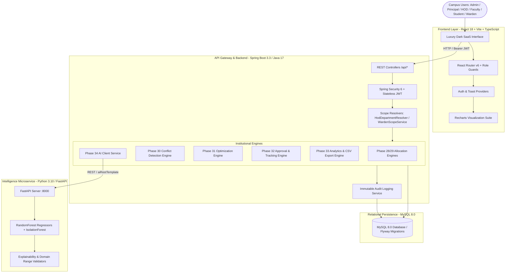

# Academic & Hostel Resource Allocation Optimization Dashboard (AHRAO)

> **Short Name:** AHRAO  
> **Status:** Production Ready (Phases 1–35 Complete)  
> **Primary Alignment:** UN Sustainable Development Goal 4 (Quality Education)  
> **Architecture:** Three-Tier Enterprise System (React SPA + Spring Boot Gateway + FastAPI AI Microservice + MySQL 8.0)

---

## 1. Project Title
**Academic & Hostel Resource Allocation Optimization Dashboard (AHRAO)**  
*An Enterprise College Infrastructure & Allocation Intelligence Platform.*

---

## 2. Project Overview
AHRAO is an enterprise-grade web application engineered to unify, optimize, and streamline the two foundational physical operational pillars of higher education institutions:
1. **Academic Resource Operations**: Classrooms, computing laboratories, specialized equipment, faculty teaching workload balance, timetable clash resolution, and multi-tier requisition workflows.
2. **Hostel Residential Operations**: Residential blocks, room inventories, bed vacancies, student check-ins/allocations, grievance routing, and facility maintenance lifecycles.

By fusing deterministic constraint algorithms, mathematical optimization, real-time database analytics, and machine learning models, AHRAO bridges institutional resource fragmentation into a cohesive, role-governed operational dashboard.

---

## 3. Problem Statement
Higher education institutions routinely experience severe operational friction:
- **Facility Misallocation & Idle Capacity**: State-of-the-art computer labs and lecture halls sit vacant during off-peak hours while departments compete for identical rooms during peak midday intervals.
- **Faculty Teaching Disparities & Burnout**: Lack of centralized scheduling visibility results in unbalanced teaching credit hours across faculty cohorts.
- **Hostel Residential Bottlenecks**: Manual paper-based or disconnected spreadsheet ledgers lead to overbooking, untracked bed vacancies, delayed grievance handling, and uncoordinated maintenance.
- **Siloed Administrative Governance**: Principals, Heads of Departments (HODs), Faculty, Students, and Wardens operate on isolated tools without real-time conflict prevention or unified audit telemetry.

AHRAO replaces fragmented departmental tools with a single source of operational truth backed by mathematical constraint enforcement and predictive AI.

---

## 4. SDG 4 Connection (Quality Education)
AHRAO directly advances **UN Sustainable Development Goal 4 (Quality Education)** by:
- **Target 4.a**: Upgrading academic infrastructure (laboratories, smart classrooms, computing centers) through transparent capacity utilization tracking and conflict-free allocation.
- **Optimizing Instructional Delivery**: Preventing classroom clashes and reducing faculty administrative overhead, maximizing effective instruction time.
- **Equitable Living Environments**: Providing transparent, fair hostel bed distribution and rapid maintenance turnaround for student residential facilities.

---

## 5. Core Objectives
- **Centralized Infrastructure Inventory**: Maintain a real-time, auditable telemetry record of all physical academic and residential assets.
- **Eliminate Double-Bookings & Clashes**: Enforce deterministic hard constraint validation across rooms, time slots, section cohorts, and faculty members.
- **Balanced Faculty Workload**: Track weekly contact hours and course assignments to ensure balanced distribution within academic departments.
- **Automated Residential Governance**: Deliver automated bed mapping, real-time vacancy tracking, digital grievance routing, and facility maintenance ticketing.
- **Explainable Decision Intelligence**: Provide administrators with predictive demand forecasting, utilization projections, and quantitative optimization recommendations.
- **Strict Role-Based Security**: Guarantee least-privilege access boundaries across institutional tiers via stateless JWT and Spring Security 6.

---

## 6. Key Features
- **Deterministic Conflict Engine (Phase 30)**: Real-time verification of double-booking, timetable clashes, faculty overlaps, capacity limits, and warden boundaries.
- **Mathematical Optimization Engine (Phase 31)**: Normalized multi-factor candidate scoring (0–100) recommending optimal rooms and beds while minimizing capacity waste.
- **Multi-Tier Approval Workflow (Phase 32)**: Configurable approval chains with anti-self-approval enforcement, pre-allocation conflict re-checking, and chronological lifecycle timelines.
- **Live Utilization Analytics (Phase 33)**: Direct database SQL aggregations (`COUNT`, `SUM`, `AVG`, `GROUP BY`) displaying interactive Recharts distributions, ranking tables, and RFC-4180 CSV exports.
- **AI Intelligence Microservice (Phase 34)**: Python FastAPI service running Scikit-Learn models (`RandomForestRegressor`, `IsolationForest`) for demand prediction, bed shortage detection, and explainable recommendations using real historical data.
- **Hardened Multi-Component Health Telemetry (Phase 35)**: Dual `/health` endpoints reporting Application, MySQL Database, and AI microservice health with zero credential exposure.

---

## 7. User Roles & Access Hierarchy

| Role | Operational Scope | Core Responsibilities |
| :--- | :--- | :--- |
| **ADMIN** | System-Wide | Master data management, user provisioning, global audit logs, system parameters, and ML model retraining. |
| **PRINCIPAL** | Institutional | Executive campus oversight, cross-department monitoring, inter-departmental bottleneck resolution, and final approvals. |
| **HOD** | Departmental | Faculty workload balancing, curriculum-to-room scheduling, department lab requisitions, and departmental timetable governance. |
| **FACULTY** | Instructional | Assigned course schedules, personal workload metrics, lab/classroom reservation requests, and profile maintenance. |
| **STUDENT** | Individual | Class timetable viewing, learning resource requisitions, hostel bed status, and maintenance/complaint submissions. |
| **WARDEN** | Residential | Assigned hostel blocks, room inventory, bed occupancy management, check-ins/check-outs, and maintenance ticket dispatch. |

---

## 8. System Architecture



---

## 9. Technology Stack

### Frontend
- **Framework**: React 18+ with TypeScript (Strict Mode)
- **Bundler & Tooling**: Vite 6
- **Routing**: React Router v6
- **Styling**: Tailwind CSS (Curated Dark SaaS Palette)
- **Visualizations**: Recharts 2.x
- **Icons**: Lucide React
- **HTTP Client**: Axios (configured with interceptors, standard error wrapping)

### Backend
- **Framework**: Spring Boot 3.3.3 (Java 17)
- **Security**: Spring Security 6 (Stateless JWT, CORS, BCrypt hashing)
- **Persistence**: Spring Data JPA / Hibernate 6
- **Database Migrations**: Flyway
- **Connection Pool**: HikariCP
- **Database**: MySQL 8.0+

### AI / Machine Learning Service
- **Microservice Framework**: Python 3.10 / FastAPI
- **Web Server**: Uvicorn
- **Data Engineering**: Pandas 2.2+, NumPy 1.26.4
- **Machine Learning**: Scikit-Learn 1.4+ (`RandomForestRegressor`, `IsolationForest`)
- **Model Serialization**: Joblib

---

## 10. Module Architecture

AHRAO is partitioned into 7 modular institutional domains:
1. **User & Identity Directory**: User accounts, BCrypt passwords, role assignments, student records, faculty profiles, and warden assignments.
2. **Academic Infrastructure Catalog**: Departments, programs, sections, semesters, academic years, classrooms, computing laboratories, and equipment.
3. **Residential Infrastructure Catalog**: Hostels, blocks, floors, rooms, and individual bed units.
4. **Requisition Engine**: Academic resource requests and hostel room/bed change requests.
5. **Allocation & Constraint Engines**: Academic allocation, hostel bed allocation, and timetable conflict matrix.
6. **Governance & Approval Engine**: Approval pipelines, multi-milestone lifecycle timelines, and immutable audit logging.
7. **Analytics & AI Intelligence Engine**: Aggregation queries, utilization telemetry, ML demand forecasts, and explainable recommendations.

---

## 11. Database Architecture & ER Model

The relational schema is maintained through Flyway migrations (`V1` to `V6`):
- `users`, `roles`, `permissions`, `user_roles`
- `departments`, `programs`, `sections`, `academic_years`, `semesters`, `subjects`
- `faculty`, `students`, `department_hods`, `principal_assignments`, `wardens`
- `resources`, `resource_categories`, `classrooms`, `laboratories`, `equipment`, `time_slots`
- `hostels`, `hostel_blocks`, `hostel_floors`, `hostel_rooms`, `hostel_beds`, `hostel_facilities`
- `academic_resource_requests`, `hostel_requests`, `resource_allocations`, `hostel_allocations`
- `approvals`, `approval_actions`, `audit_logs`, `notifications`, `system_settings`

---

## 12. Academic Resource Allocation Workflow

```
1. Requisition: Faculty/Student creates Academic Resource Request.
2. Optimization Preview: Phase 31 scores available candidate rooms/labs.
3. Approval: Department HOD or Principal reviews request.
4. Conflict Revalidation: Phase 30 performs mandatory pre-allocation double-booking check.
5. Allocation Commit: Phase 28 assigns facility, updates status to ALLOCATED.
6. Tracking & Audit: Milestone logged in tracking timeline and audit_logs.
```

---

## 13. Hostel Resource Allocation Workflow

```
1. Application: Student submits Hostel Requisition / Room Change Request.
2. Capacity & Eligibility Check: Warden reviews student standing and bed eligibility.
3. Optimization: Phase 31 ranks available beds by floor, occupancy, and room preferences.
4. Conflict Check: Phase 30 verifies student has no existing active bed allocation.
5. Allocation Commit: Phase 29 maps student to bed, flips bed status to OCCUPIED.
6. Check-Out / Release: When student departs, allocation releases bed to AVAILABLE.
```

---

## 14. Conflict Detection & Constraint Management (Phase 30)

The conflict detection engine strictly enforces institutional constraints prior to any allocation:
- **Hard Constraints**:
  - `DOUBLE_BOOKING`: Resource already allocated during target time window.
  - `TIMETABLE_CLASH`: Faculty or section assigned to another classroom in the same period.
  - `CAPACITY_EXCEEDED`: Class cohort size exceeds physical classroom seating capacity.
  - `STUDENT_ALREADY_ALLOCATED`: Student already holds an active hostel bed.
  - `BED_ALREADY_OCCUPIED`: Bed already allocated to another resident.
  - `WARDEN_UNAUTHORIZED`: Warden lacks operational jurisdiction over the requested building.
- **Failure Response**: Returns `409 Conflict` with a structured list of detected clashes.

---

## 15. Optimization & Recommendation Engine (Phase 31)

Provides explainable, deterministic mathematical scoring (0–100) across candidate resources:
- **Academic Scoring Weights**: Capacity Fit (30%), Resource Suitability (25%), Utilization Balance (20%), Department Proximity (15%), Historical Preference (10%).
- **Hostel Scoring Weights**: Room Occupancy Balance (30%), Student Program Proximity (25%), Floor Level (20%), Facility Proximity (15%), Capacity Waste Minimization (10%).
- **Explainability**: Every recommendation includes candidate rankings, factor score breakdowns, and human-readable justification.

---

## 16. Approval Workflow & Lifecycle Tracking (Phase 32)

- **Anti-Self-Approval**: Requesters are strictly prohibited from approving their own requisitions (`403 Forbidden`).
- **Scope-Based Routing**: Faculty requisitions route to HOD; HOD requisitions route to Principal; Student hostel requests route to Warden.
- **Pessimistic Recheck**: Mandatory Phase 30 conflict verification is performed immediately before final allocation dispatch.
- **Chronological Timeline**: Visual milestone progression (`REQUESTED` $\to$ `UNDER_REVIEW` $\to$ `APPROVED` $\to$ `ALLOCATED` $\to$ `COMPLETED`).

---

## 17. Utilization Analytics, Charts & Reports (Phase 33)

- **SQL Aggregations**: All numbers calculated directly in MySQL via JPA/JPQL (`COUNT`, `SUM`, `AVG`, `GROUP BY`) with zero in-memory table streaming.
- **Division Safety**: Guaranteed safe division (`safeDiv`) returning `0.0` on zero/empty denominators.
- **Dynamic Filters**: Cascading filters for Year, Semester, Department, Category, Hostel, Block, Floor, Room, and flexible Date Ranges.
- **Audit-Ready CSV Exports**: 1-click RFC-4180 UTF-8 CSV downloads across 7 reporting domains with audit logging.

---

## 18. AI Insights, Prediction & Recommendation (Phase 34)

- **Real Data Principle**: Strict threshold (`MIN_TRAINING_RECORDS = 5`). If records are insufficient, returns `INSUFFICIENT_DATA` rather than fabricated statistics.
- **Models**:
  - `RandomForestRegressor`: Forecasts future reservation volume and 30-day forward utilization %.
  - `RandomForestRegressor`: Projects hostel block occupancy and bed requirements.
  - `IsolationForest`: Unsupervised operational anomaly and requisition spike detection.
- **Decision Support Only**: AI **NEVER** mutates database state, approves requisitions, or automatically assigns resources.
- **Resilience**: If the AI microservice is offline, Spring Boot returns `AI_SERVICE_UNAVAILABLE` with zero application downtime.

---

## 19. Security Architecture

1. **Stateless JWT**: Cryptographically signed tokens using HMAC-SHA256 with configurable expiration.
2. **Password Security**: Strong BCrypt hashing; passwords never returned in DTOs or logged.
3. **CORS Governance**: Configurable allowed origins (`FRONTEND_URL`); no wildcard `*` with credentials.
4. **Scope-Based Authorization**:
   - `HOD`: Restricted to department via `HodDepartmentResolver`.
   - `WARDEN`: Restricted to assigned hostels via `WardenScopeService`.
   - `FACULTY`: Restricted to personal workload.
   - `ADMIN` & `PRINCIPAL`: Campus-wide governance.
5. **SQL Injection Prevention**: 100% parameterized JPA/JPQL queries.
6. **Immutable Audit Logs**: Records user, action, target entity, timestamp, and metadata.

---

## 20. API Documentation Reference

### Public Endpoints
- `GET /health` or `GET /api/health`: System health telemetry (Application, MySQL, AI Microservice).
- `POST /api/auth/login`: Authenticates credentials, returns Bearer JWT.

### Administrative Endpoints (`ROLE_ADMIN`)
- `GET/POST /api/admin/users`: User provisioning and governance.
- `GET/POST /api/admin/academic/*`: Departments, programs, sections, subjects.
- `GET/POST /api/admin/resources/*`: Classrooms, laboratories, equipment.
- `POST /api/ai/models/train`: Triggers model retraining on live institutional data.

### Approvals & Allocation Endpoints
- `GET /api/approvals`: Filterable approval queue.
- `POST /api/approvals/{id}/approve`: Validates conflicts and commits allocation.
- `POST /api/approvals/{id}/reject`: Records rejection rationale.
- `GET /api/approvals/{id}/timeline`: Chronological lifecycle milestones.

### Analytics Endpoints
- `GET /api/analytics/overview`: Campus KPI summary.
- `GET /api/analytics/academic/*`: Classrooms, labs, equipment, workload.
- `GET /api/analytics/hostel/*`: Occupancy, rooms, complaints, maintenance.
- `GET /api/analytics/reports/export`: RFC-4180 CSV export download.

### AI Intelligence Endpoints
- `GET /api/ai/overview`: AI predictions, shortages, bottlenecks, and recommendations.
- `GET /api/ai/academic/demand`: Forward academic demand forecast.
- `GET /api/ai/academic/utilization`: Forward 30-day utilization forecast.
- `GET /api/ai/hostel/occupancy`: Forward residential occupancy forecast.
- `GET /api/ai/recommendations`: Prioritized decision-support recommendations.

---

## 21. Installation Prerequisites

- **Java Development Kit (JDK)**: OpenJDK 17 or Eclipse Adoptium 17+
- **Build Tool**: Apache Maven 3.9+
- **Node.js**: Node.js 18+ or 20+ with npm
- **Database**: MySQL Server 8.0+
- **Python**: Python 3.10+ (with pip)

---

## 22. Environment Variables

Copy `.env.example` to create local configuration files:

```bash
# Frontend (frontend/.env)
VITE_API_BASE_URL=http://localhost:8080/api

# Backend (backend/.env or system environment)
DB_HOST=localhost
DB_PORT=3306
DB_NAME=academic_hostel_resource_allocation
DB_USERNAME=root
DB_PASSWORD=your_secure_password
JWT_SECRET=404E635266556A586E3272357538782F413F4428472B4B6250645367566B5970
JWT_EXPIRATION_MS=86400000
FRONTEND_URL=http://localhost:5173
AI_SERVICE_URL=http://127.0.0.1:8000
AI_CONNECT_TIMEOUT_MS=3000
AI_READ_TIMEOUT_MS=8000
MIN_TRAINING_RECORDS=5

# AI Service (ai-service/.env)
AI_HOST=0.0.0.0
AI_PORT=8000
MIN_TRAINING_RECORDS=5
```

---

## 23. Running Locally

### Step 1: Initialize Database
```sql
CREATE DATABASE academic_hostel_resource_allocation CHARACTER SET utf8mb4 COLLATE utf8mb4_unicode_ci;
```

### Step 2: Start Python AI Microservice
```bash
cd ai-service
pip install -r requirements.txt
python -m uvicorn app.main:app --host 127.0.0.1 --port 8000
```
*Verify:* `http://127.0.0.1:8000/health` returns `status: "UP"`.

### Step 3: Start Spring Boot Backend
```bash
cd backend
mvn spring-boot:run
```
*Verify:* `http://localhost:8080/health` returns `status: "UP"` with Application, Database, and AI status.

### Step 4: Start Frontend SPA
```bash
cd frontend
npm install
npm run dev
```
*Access Application:* `http://localhost:5173`

---

## 24. Automated Testing

### Backend Test Suite (466 Tests)
```bash
cd backend
mvn clean test
```
*Expected Result:* `BUILD SUCCESS` (466 tests passed, 0 failures, 0 errors).

### AI Service Test Suite (9 Tests)
```bash
cd ai-service
python -m pytest tests -v
```
*Expected Result:* `9 passed in ~9.87s`.

### Frontend TypeScript Compilation & Build
```bash
cd frontend
npm run build
```
*Expected Result:* `tsc -b` 0 errors, Vite production bundle generated.

---

## 25. Production Deployment Guide

### 1. Build Production Artifacts
```bash
# Package Backend Executable JAR
cd backend
mvn clean package -DskipTests
# Output: backend/target/ahrao-backend-1.0.0-SNAPSHOT.jar

# Build Frontend Production Bundle
cd frontend
npm run build
# Output: frontend/dist/
```

### 2. Run in Production
- **Database**: Run MySQL with connection pooling enabled. Flyway will automatically validate migrations on startup.
- **AI Service**: Deploy with production WSGI/ASGI workers:
  ```bash
  gunicorn app.main:app -w 4 -k uvicorn.workers.UvicornWorker --bind 0.0.0.0:8000
  ```
- **Backend Service**:
  ```bash
  java -jar -Dspring.profiles.active=prod ahrao-backend-1.0.0-SNAPSHOT.jar
  ```
- **Frontend SPA**: Serve `frontend/dist` via NGINX or reverse proxy pointing `/api/*` to `http://localhost:8080/api/*`.

---

## 26. User Interface & Dashboards

The application features a dark SaaS interface designed for administrative efficiency:
- **Admin Console**: Master data, user directories, system telemetry, and model training.
- **Principal Portal**: Executive campus-wide utilization charts, bottleneck tracking, and approval escalations.
- **HOD Workspace**: Department workload distribution, room-to-curriculum mapping, and lab requisition queue.
- **Faculty Desk**: Assigned timetable schedule, workload metrics, and classroom booking requests.
- **Student Portal**: Class schedules, learning resource requisitions, and hostel room/complaint dashboard.
- **Warden Console**: Building/block/room hierarchy, bed occupancy grid, and maintenance ticketing.
- **AI Insights & Recommendations Hub**: 6-tab telemetry suite separating `ACTUAL` metrics from `PREDICTED` ML outputs.

---

## 27. Documented Limitations

Refer to [KNOWN_ISSUES.md](file:///c:/Users/KAVIRAJ/Desktop/PROJECT/Mini%20project-KK/KNOWN_ISSUES.md) for full operational boundaries:
1. **Cold-Start Threshold**: Requires minimum 5 historical records before predictive models activate.
2. **Unsupervised Outlier Labelling**: Anomaly indicators are based on statistical deviations ($z$-score / Isolation Forest) for administrative review.
3. **CSV vs. PDF**: Export generation produces standard RFC-4180 UTF-8 CSVs.

---

## 28. Future Enhancements

- Integration with IoT smart door locks and RFID badges for automated physical room check-in.
- Direct PDF report generator using headless Chromium or PDFBox.
- Multi-campus multi-tenant partitioning for university systems with geographically separated branches.
- Mobile native companions (React Native / Flutter) for Warden on-floor bed audits and student complaint photo attachments.

---

## 29. Project Governance & Team Information

- **Project:** Academic & Hostel Resource Allocation Optimization Dashboard (AHRAO)
- **Repository:** [https://github.com/KAVIRAJ-27/Academic-Resource-Allocation-Optimization-Dashboard-KK](https://github.com/KAVIRAJ-27/Academic-Resource-Allocation-Optimization-Dashboard-KK)
- **Governance:** Role-Based Access Control (RBAC) & Immutable Audit Telemetry
- **License:** Proprietary Institutional License / All Rights Reserved