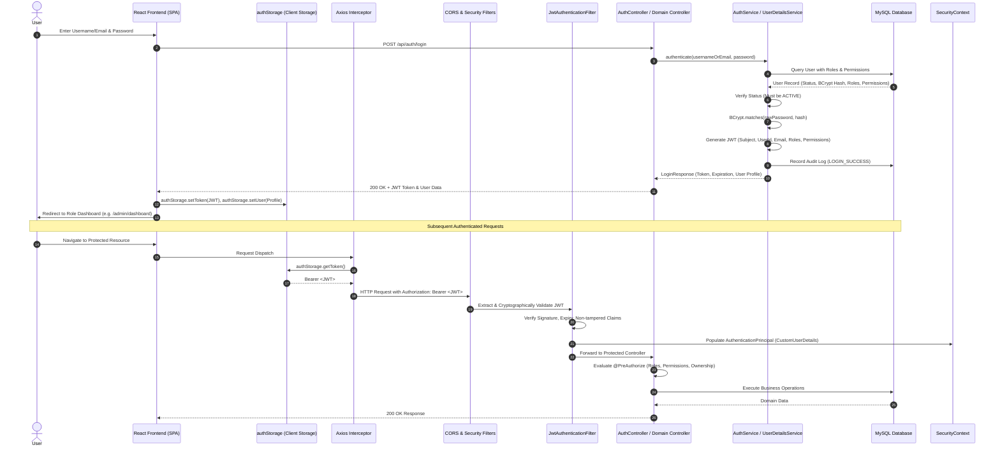

# AHRAO Authentication, JWT & Role-Based Access Control (RBAC) Specification

> **Phase:** Phase 3 — Authentication, JWT & Role-Based Access Control  
> **Status:** Production-Ready & Verified  
> **Backend:** Spring Boot 3.3 / Spring Security 6 (Stateless JWT, BCrypt, Method Security)  
> **Frontend:** React 18 / TypeScript / Vite / Axios Interceptors / Protected Routes  

---

## 1. Authentication Architecture

AHRAO uses an enterprise-grade stateless authentication architecture powered by **Spring Security 6** and **JSON Web Tokens (JJWT)**. Passwords are never stored in plaintext and are salted and hashed using **BCrypt** with an adaptive work factor.

### Authentication & Authorization Flow



---

## 2. Six System Roles & Operational Boundaries

The platform strictly enforces **exactly six** institutional roles without aliases:

| Role | Scope | Dashboard Route | Authorized Boundaries |
| :--- | :--- | :--- | :--- |
| **`ADMIN`** | System-Wide | `/admin/dashboard` | User & role directory governance, institution configurations, global telemetry, credential resets, audit logs. |
| **`PRINCIPAL`** | Institutional | `/principal/dashboard` | Campus-wide utilization oversight, inter-departmental bottleneck resolution, institutional approvals. |
| **`HOD`** | Departmental | `/hod/dashboard` | Department faculty workload, student enrollments, course allocation, laboratory requisitions. |
| **`FACULTY`** | Instructional | `/faculty/dashboard` | Assigned course timetables, personal teaching workload, lab reservations, resource requisitions. |
| **`STUDENT`** | Individual | `/student/dashboard` | Course schedules, hostel bed allocation, room telemetry, maintenance requests & grievances. |
| **`WARDEN`** | Residential | `/warden/dashboard` | Hostel blocks, floors, rooms, bed occupancies, maintenance work orders, mess administration. |

---

## 3. Permission Foundation

AHRAO uses a normalized many-to-many role-permission mapping (`roles`, `permissions`, `role_permissions`). The Spring Security principal (`CustomUserDetails`) exposes both role authorities (`ROLE_<name>`) and granular privilege authorities:

- `USER_READ`: Inspect user directory records
- `USER_WRITE`: Provision and modify accounts
- `ACADEMIC_READ`: View departmental courses, schedules, and spaces
- `ACADEMIC_ALLOCATE`: Schedule classrooms, labs, and time slots
- `HOSTEL_READ`: Inspect hostel blocks, rooms, and occupancies
- `HOSTEL_ALLOCATE`: Assign beds and manage residential check-ins
- `APPROVAL_MANAGE`: Approve or reject academic and hostel requisitions
- `SYSTEM_ADMIN`: Global system settings and audit telemetry

### Method Security Annotations

Controllers enforce authorization using Spring's `@PreAuthorize`:
```java
// Role Check
@PreAuthorize("hasRole('ADMIN')")

// Multi-Role Check
@PreAuthorize("hasAnyRole('PRINCIPAL', 'ADMIN')")

// Permission Check
@PreAuthorize("hasAuthority('ACADEMIC_ALLOCATE')")

// Reusable Ownership & Scope Check via SecurityEvaluationService
@PreAuthorize("@securityEvaluationService.isOwner(#userId)")
```

---

## 4. Account Status Lifecycle

Only accounts with status **`ACTIVE`** are permitted to authenticate. All other states trigger specific exceptions and immutable security audit logs:

| Status | Authentication Behavior | HTTP Response | Audit Action Recorded |
| :--- | :--- | :--- | :--- |
| **`ACTIVE`** | Permitted; JWT issued | `200 OK` | `LOGIN_SUCCESS` |
| **`SUSPENDED`** | Blocked; `LockedException` | `403 Forbidden` | `LOGIN_BLOCKED_SUSPENDED` |
| **`INACTIVE`** | Blocked; `DisabledException` | `403 Forbidden` | `LOGIN_BLOCKED_INACTIVE` |
| **`PENDING`** | Blocked; `DisabledException` | `403 Forbidden` | `LOGIN_BLOCKED_PENDING` |
| **Invalid Password** | Blocked; `BadCredentialsException` | `401 Unauthorized` | `LOGIN_FAILURE_BAD_CREDENTIALS` |
| **Nonexistent User** | Blocked; `BadCredentialsException` | `401 Unauthorized` | `LOGIN_FAILURE` |

---

## 5. Authentication REST APIs

### 1. User Login
- **Endpoint**: `POST /api/auth/login`
- **Access**: Public
- **Request Body**:
  ```json
  {
    "usernameOrEmail": "admin",
    "password": "Admin@123"
  }
  ```
- **Success Response (`200 OK`)**:
  ```json
  {
    "success": true,
    "message": "Authentication successful",
    "data": {
      "accessToken": "eyJhbGciOiJIUzI1NiIsInR5cCI6IkpXVCJ9...",
      "tokenType": "Bearer",
      "expiresIn": 86400000,
      "userId": 1,
      "username": "admin",
      "email": "admin@ahrao.edu",
      "firstName": "System",
      "lastName": "Administrator",
      "roles": ["ADMIN"],
      "permissions": ["USER_READ", "USER_WRITE", "SYSTEM_ADMIN", "ACADEMIC_ALLOCATE", "HOSTEL_ALLOCATE"],
      "status": "ACTIVE"
    },
    "timestamp": "2026-09-05T19:20:00.000Z"
  }
  ```

### 2. Current User Profile
- **Endpoint**: `GET /api/auth/me`
- **Access**: Authenticated (Requires `Bearer <JWT>`)
- **Success Response (`200 OK`)**:
  ```json
  {
    "success": true,
    "message": "Current user profile retrieved",
    "data": {
      "id": 1,
      "username": "admin",
      "email": "admin@ahrao.edu",
      "firstName": "System",
      "lastName": "Administrator",
      "phone": "+91 98765 00001",
      "roles": ["ADMIN"],
      "permissions": ["USER_READ", "USER_WRITE", "SYSTEM_ADMIN"],
      "status": "ACTIVE",
      "lastLoginAt": "2026-09-05T14:30:00Z"
    }
  }
  ```

### 3. User Registration
- **Endpoint**: `POST /api/auth/register`
- **Access**: Public
- **Request Body**:
  ```json
  {
    "username": "elena_r",
    "email": "elena@ahrao.edu",
    "password": "Faculty@123",
    "firstName": "Elena",
    "lastName": "Rostova",
    "phone": "+91 98765 43210",
    "role": "FACULTY"
  }
  ```
- **Success Response (`201 Created`)**

### 4. Logout
- **Endpoint**: `POST /api/auth/logout`
- **Access**: Authenticated (Client clears `authStorage` token and session)

### 5. Change Password
- **Endpoint**: `POST /api/auth/change-password`
- **Access**: Authenticated
- **Request Body**:
  ```json
  {
    "currentPassword": "OldPassword@123",
    "newPassword": "NewPassword@2026"
  }
  ```

---

## 6. Frontend Token Management & Route Guards

### Centralized `authStorage.ts`
All token access is strictly encapsulated:
- `authStorage.getToken()`
- `authStorage.setToken(token)`
- `authStorage.removeToken()`
- `authStorage.clearAuth()`

### Route Guards
- `<ProtectedRoute>`: Enforces active authentication session. Redirects to `/login` if unauthenticated.
- `<RoleGuard allowedRoles={[ROLES.ADMIN]}>`: Enforces institutional role membership. Redirects to `/unauthorized` if forbidden.
- `<PermissionGuard permission="ACADEMIC_ALLOCATE">`: Evaluates fine-grained privilege markers.
