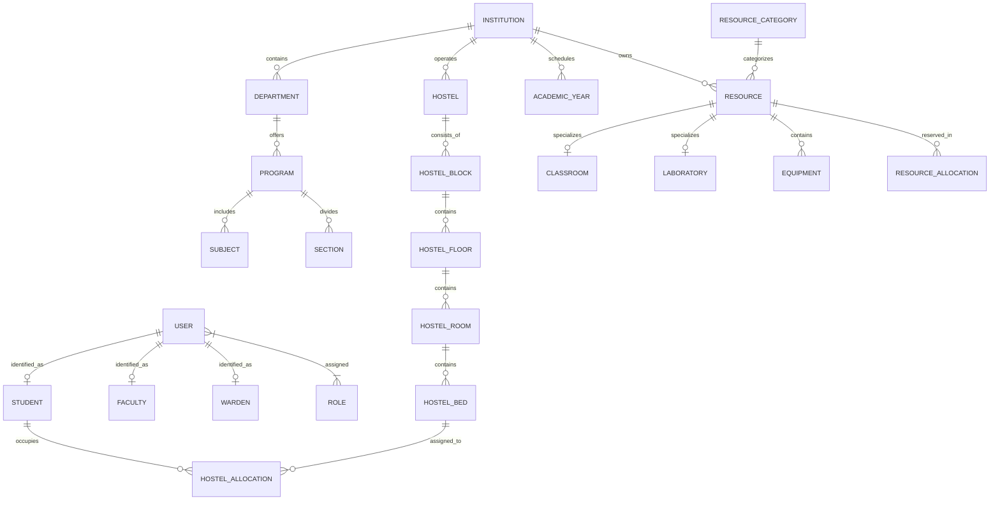
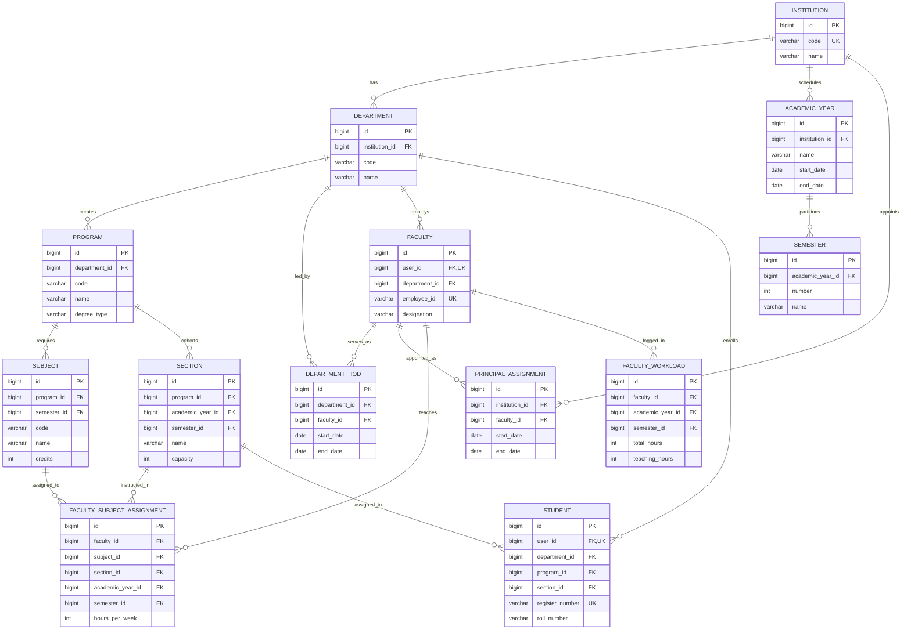
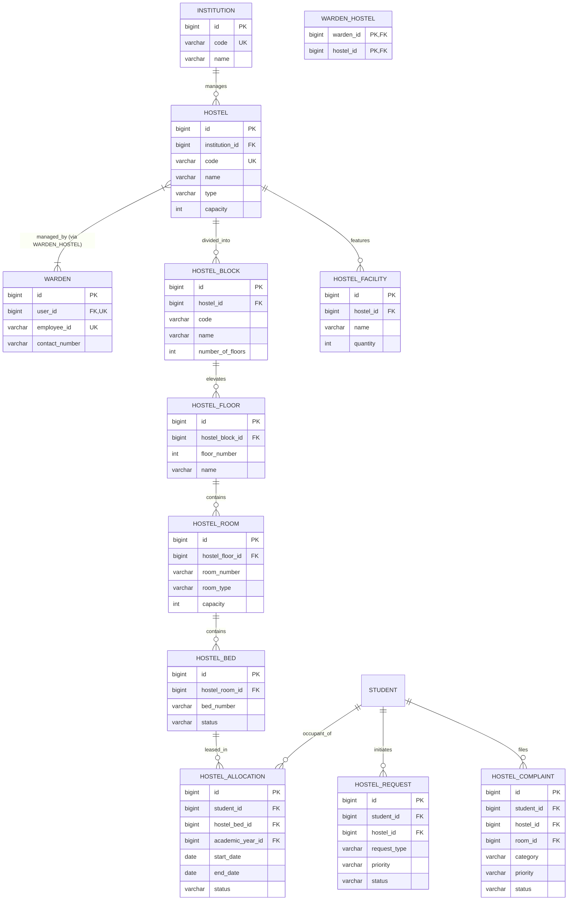
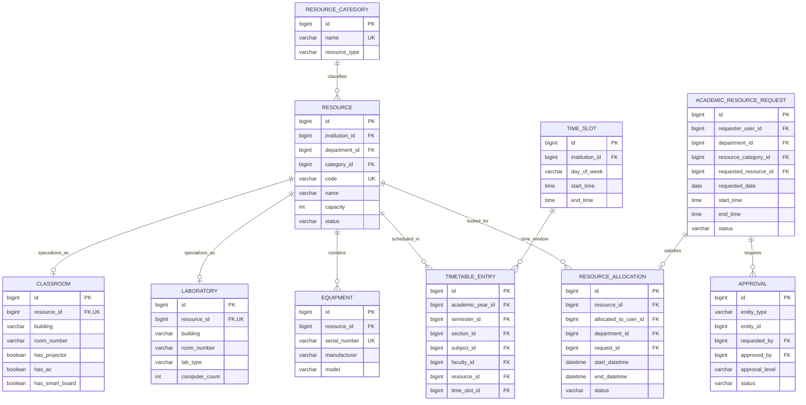

# AHRAO Database Entity-Relationship (ER) Diagram

The following Mermaid diagrams illustrate the complete relational database architecture and hierarchies for the **Academic & Hostel Resource Allocation Optimization Dashboard (AHRAO)**.

---

## 1. High-Level System Relationships

---

## 2. Academic Hierarchy & Teaching Load

---

## 3. Hostel Structure & Room/Bed Hierarchy

---

## 4. Academic Resource Allocation & Timetable Conflict Model

