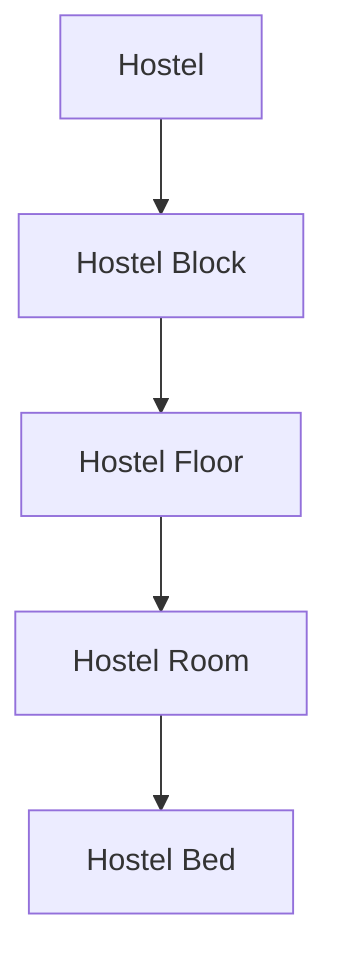

# Student Hostel Module (Phase 15)

## 1. Overview & Purpose
The **Student Hostel Module** (Phase 15 of the Academic & Hostel Resource Allocation Optimization Dashboard - AHRAO) delivers a unified, strictly **read-only** interface for enrolled students to inspect their institutional residential status, assigned hostel building, block hierarchy, room specifications, allocated bedspace, common facilities, and designated warden contact details.

> [!IMPORTANT]
> **This phase provides hostel information viewing ONLY.**
> A student can only view their residential assignment. Bed selection, room allocation, hostel transfer requests, hostel complaints, and maintenance workflows are managed in future phases of AHRAO.

---

## 2. Student Permissions & Zero-Trust Ownership

1. **Role Authorization**:
   - All endpoints under `/api/student/hostel/**` are protected by `@PreAuthorize("hasRole('STUDENT')")` and require valid JWT authentication.
   - Non-student roles (Admin, Faculty, HOD, Principal, Warden) receive `403 Forbidden`.
   - Unauthenticated requests receive `401 Unauthorized`.

2. **Ownership Isolation**:
   - A student can access **ONLY** their own residential and allocation information.
   - Requester identity is resolved directly from the authenticated JWT principal (`SecurityUtils.getCurrentUserId()`).
   - Query parameters such as `studentId` or path parameters targeting other students are rejected; cross-student data access is impossible.

3. **Strictly Read-Only Access**:
   - Students cannot assign, reassign, reserve, or vacate beds or rooms.
   - Students cannot modify `HostelAllocation`, `HostelBed`, `HostelRoom`, or `Hostel` entities.

---

## 3. Structural Hierarchy

The residential allocation reflects the established 5-tier structural model:



Example:
- **Hostel**: Nilgiri Boys Hostel (`HSTL-NB-01`, Type: `BOYS`)
- **Block**: Block A (`BLK-A`, 4 Floors)
- **Floor**: Second Floor (Level 2)
- **Room**: Room A-204 (Type: `DOUBLE`, Capacity: 2)
- **Bed**: Bed A-204-B1 (Status: `OCCUPIED`)

---

## 4. API Endpoints

All student hostel endpoints are prefixed with `/api/student/hostel`:

| Method | Endpoint | Description | Security |
|---|---|---|---|
| `GET` | `/api/student/hostel` | Retrieve current hostel allocation, 5-tier hierarchy, room capacity/occupancy, active facilities, assigned wardens, and historical records | `ROLE_STUDENT`, Own Records |
| `GET` | `/api/student/hostel/history` | Retrieve student's past residential tenure records | `ROLE_STUDENT`, Own Records |

---

## 5. Facilities & Warden Visibility

1. **Hostel Facilities**:
   - Only facilities explicitly mapped to the student's allocated hostel are retrieved via `hostelFacilityRepository.findByHostelId(hostelId)`.
   - Inactive facilities are filtered out.
   - Displays facility name, resident amenity description, and available quantity.

2. **Supervisory Wardens**:
   - Only active wardens formally assigned to the student's hostel via `WardenHostels` are displayed.
   - **Student-Safe Projection**: Only public supervisory information is returned (Warden Name, Official Employee ID, Official Contact Number, Official University Email).
   - Internal credentials, password hashes, and administrative telemetry are strictly omitted.

---

## 6. Room Capacity & Safe Occupancy Derivation

- Room capacity is loaded directly from `HostelRoom.capacity`.
- Current room occupancy is computed via a targeted query on `HostelBedRepository`:
  ```java
  long occupiedBeds = hostelBedRepository.countByRoomIdAndStatus(roomId, HostelBedStatus.OCCUPIED);
  ```
- **Performance**: Eliminates $N+1$ queries and prevents loading all student entity records into memory.

---

## 7. Empty State Handling (Day Scholars & Unallocated Students)

If an enrolled student does not have an active `HostelAllocation`:
- The API responds with `allocated: false` and empty nested structures (no fake data or mock hostels).
- The frontend presents a clean status card indicating *"NOT ALLOCATED"* and an informative empty state explaining Day Scholar status.
- If the student previously held a hostel room in an earlier semester, previous allocations are rendered in the **Historical Allocation Records** table.

---

## 8. Limitations & Strict Boundaries

The following features belong to later phases and are **strictly excluded** from Phase 15:
- ❌ Automatic bed / room allocation algorithm
- ❌ Hostel application or room request submissions
- ❌ Bed reassignment or room swap workflows
- ❌ Maintenance work orders
- ❌ Student grievance and complaint management
- ❌ Occupancy prediction and AI recommendations
- ❌ Warden and administrative management tools
