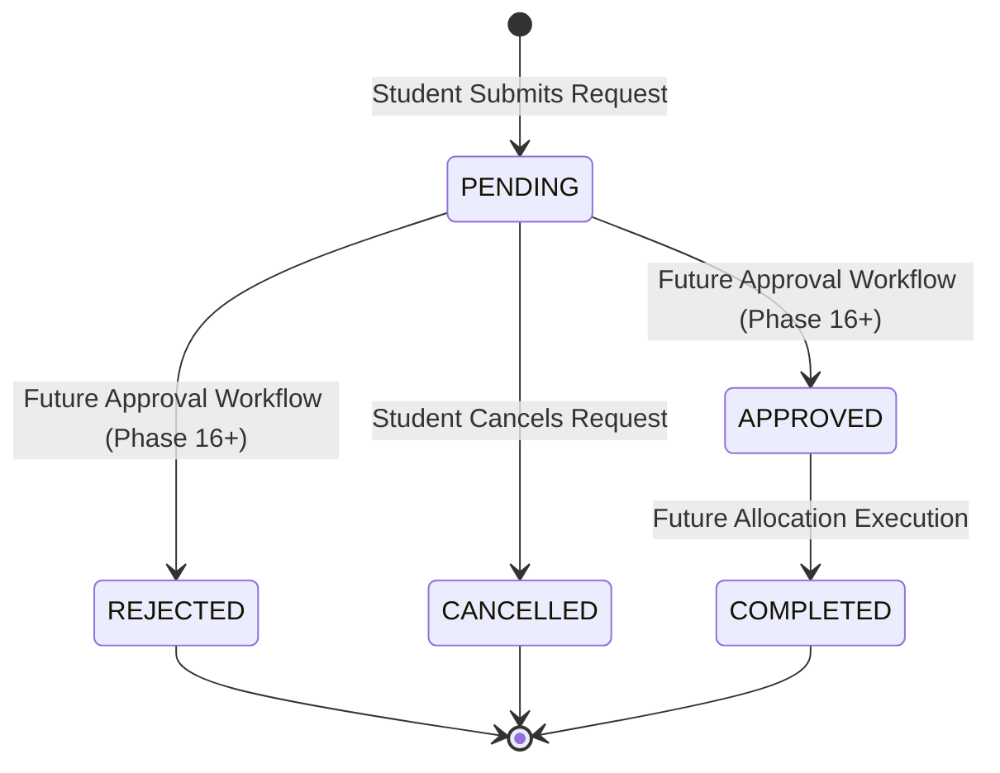

# Student Resource Requests (Phase 14)

## 1. Overview & Purpose
The **Student Resource Requests Module** (Phase 14 of the Academic & Hostel Resource Allocation Optimization Dashboard - AHRAO) provides an authenticated, controlled workflow allowing enrolled students to request access to academic venues and assets—including lecture classrooms, computing laboratories, and specialized educational equipment.

> [!IMPORTANT]
> **Request submission does NOT allocate a resource.**
> A student can only submit a requisition. Actual allocation, space collision arbitration, approval workflows (Faculty, HOD, Principal, Admin), and optimization algorithms are handled in subsequent phases of AHRAO.

---

## 2. Student Permissions & Zero-Trust Security

1. **Role Authorization**:
   - All student request endpoints under `/api/student/resource-requests/**` are protected by `@PreAuthorize("hasRole('STUDENT')")` and require valid JWT authentication.
   - Unauthorized roles (Admin, Faculty, HOD, Principal, Warden) receive `403 Forbidden`.
   - Unauthenticated callers receive `401 Unauthorized`.

2. **Ownership Isolation**:
   - A student can **ONLY** view and cancel their **own** resource requests.
   - The backend resolves the requester identity directly from the authenticated JWT principal (`SecurityUtils.getCurrentUserId()`).
   - If Student A queries or attempts to cancel a request belonging to Student B (`/api/student/resource-requests/{id}`), the backend rejects the operation with `403 Forbidden`.
   - Frontend parameters like `studentId`, `userId`, `status`, or `approvalStatus` are never accepted or trusted.

3. **No Direct Approval or Allocation**:
   - A student can **NEVER** approve, reject, allocate, or optimize resources.
   - The student can only:
     - `CREATE` a new request (initial status is always forced to `PENDING`).
     - `VIEW` their own requests (paginated, filtered, or individual details).
     - `CANCEL` their own `PENDING` request.

---

## 3. Request Lifecycle

The current Phase 14 lifecycle is strictly defined as:

### Cancellation Eligibility:
- A student may cancel a request **ONLY IF** its status is `PENDING`.
- Attempts to cancel requests in `APPROVED`, `REJECTED`, `CANCELLED`, or `COMPLETED` states are rejected with `400 Bad Request`.

---

## 4. API Endpoints

All endpoints are prefixed with `/api/student/resource-requests`:

| Method | Endpoint | Description | Security |
|---|---|---|---|
| `GET` | `/api/student/resource-requests` | Retrieve paginated list of own requests with search & status filters | `ROLE_STUDENT`, Own Records |
| `GET` | `/api/student/resource-requests/summary` | Real-time counts (Total, Pending, Approved, Rejected, Cancelled, Completed) | `ROLE_STUDENT`, Own Records |
| `GET` | `/api/student/resource-requests/resources` | List eligible resources available for student requisition | `ROLE_STUDENT` |
| `GET` | `/api/student/resource-requests/{id}` | Deep-dive details of a single request | `ROLE_STUDENT`, Ownership Enforced |
| `POST` | `/api/student/resource-requests` | Submit a new academic resource request (forced `PENDING`) | `ROLE_STUDENT` |
| `PATCH` | `/api/student/resource-requests/{id}/cancel` | Cancel an eligible `PENDING` request | `ROLE_STUDENT`, Ownership Enforced |

---

## 5. Validation & Business Rules

1. **Active Student Verification**:
   - The authenticated student's record must have `status == "ACTIVE"`. Inactive students receive `403 Forbidden`.

2. **Resource Eligibility**:
   - Resource must exist in the database.
   - Resource must **not** be in `INACTIVE` or `MAINTENANCE` status.

3. **Date Validation**:
   - `requestedDate` must not be in the past (`requestedDate >= LocalDate.now()`). Past dates are rejected with `400 Bad Request`.

4. **Time Window Validation**:
   - `startTime` must be strictly earlier than `endTime` (`startTime < endTime`).
   - Equal or inverted time ranges (`endTime <= startTime`) are rejected with `400 Bad Request`.

5. **Purpose Validation**:
   - Meaningful purpose text is mandatory (minimum 5 characters). Empty or meaningless inputs are rejected.

6. **Duplicate Request Protection**:
   - Submissions for the **same student** + **same resource** + **same date** while a request is already in `PENDING` status are rejected with `409 Conflict` ("A similar pending request already exists for this resource on the selected date").

7. **Audit Logging**:
   - Every creation and cancellation generates an immutable `AuditLog` entry:
     - `STUDENT_RESOURCE_REQUEST_CREATED`
     - `STUDENT_RESOURCE_REQUEST_CANCELLED`
   - Logs capture actor, target entity ID, IP address, user agent, and timestamp.

---

## 6. Frontend User Experience & Architecture

1. **Route**: `/student/requests` (with optional direct aliases `/student/requests/new` and `/student/requests/:id`).
2. **Summary Cards**: Displays real-time database counts for Total, Pending, Approved, Rejected, Cancelled, and Completed. Clicking a summary card activates that status filter. Zero fake numbers.
3. **Search & Filters**: Instant search across purpose, resource name/code, and category. Filter by status and request date.
4. **Responsive Table & Cards**:
   - Desktop: Tabular view with columns (Req ID, Resource & Category, Date & Time, Purpose, Priority badge, Status badge, Actions).
   - Mobile: Responsive card layout with full touch accessibility.
   - Pagination: Server-side pagination with record counts and page controls.
5. **Request Creation Modal**:
   - Real resource dropdown loaded from `/api/student/resource-requests/resources`.
   - Real-time venue metadata preview (location, seating capacity, department).
   - Date picker (`min=today`), Start Time, End Time, Priority dropdown, Purpose textarea, and optional notes.
   - Submitting state disables buttons and displays "Submitting request..." to prevent duplicate clicks.
6. **Request Details & Cancellation Modal**:
   - Complete metadata inspection (schedule, venue, requester, purpose, timestamps).
   - Accessible badges combining text, colors, and icons (`Clock`, `CheckCircle2`, `XCircle`, `Ban`, `CheckCheck`).
   - If `PENDING`, provides a dedicated Cancel action with two-step confirmation dialog.
7. **Loading & Empty States**:
   - Animated skeleton loading cards and table rows during network calls.
   - Descriptive empty states for zero requests vs. filtered empty states with reset actions.

---

## 7. Limitations & Strict Boundaries

The following capabilities belong to subsequent phases and are **strictly excluded** from Phase 14:
- ❌ Automatic resource allocation algorithm
- ❌ Resource optimization engine
- ❌ Timetable conflict detection engine
- ❌ HOD / Principal / Faculty / Admin approval workflows
- ❌ AI recommendations or demand prediction
- ❌ Hostel resource requests or room allocation
- ❌ Maintenance work orders and student complaints
